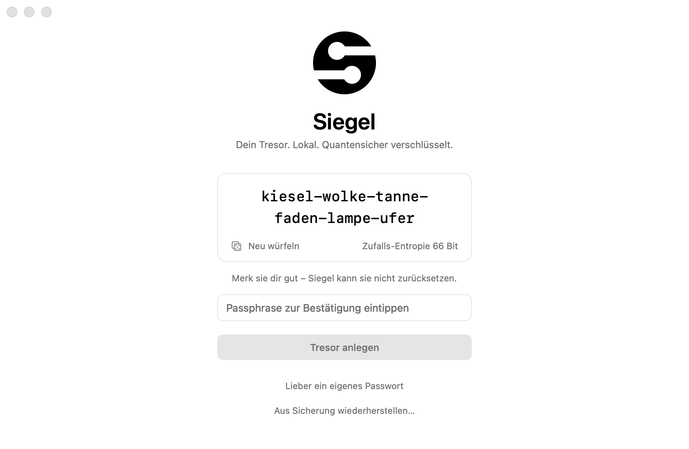
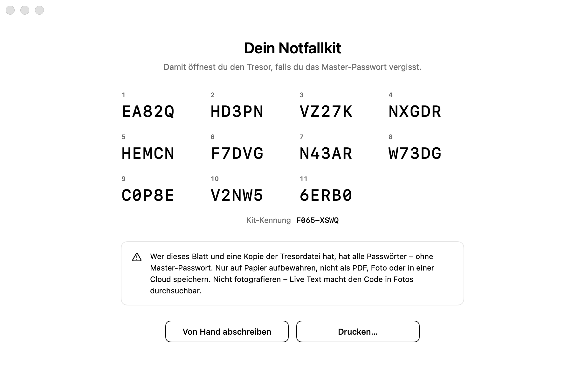
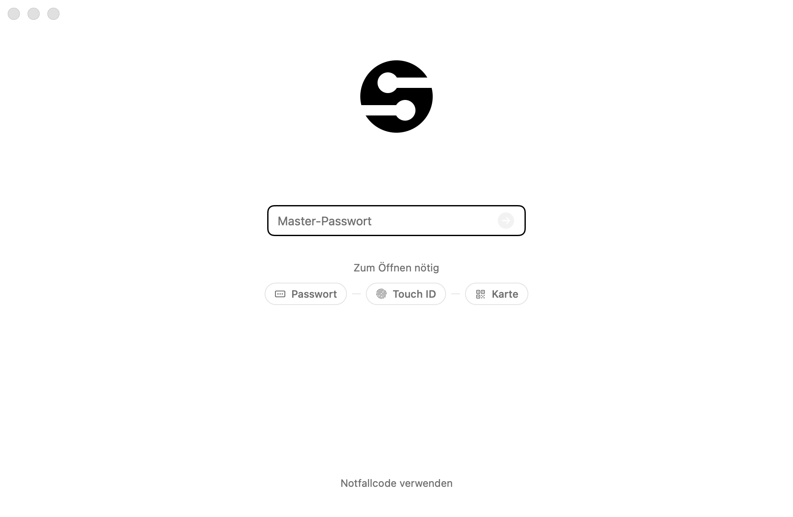
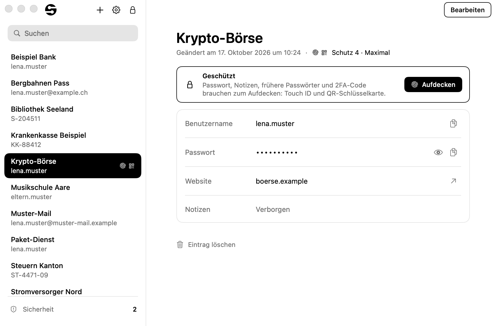
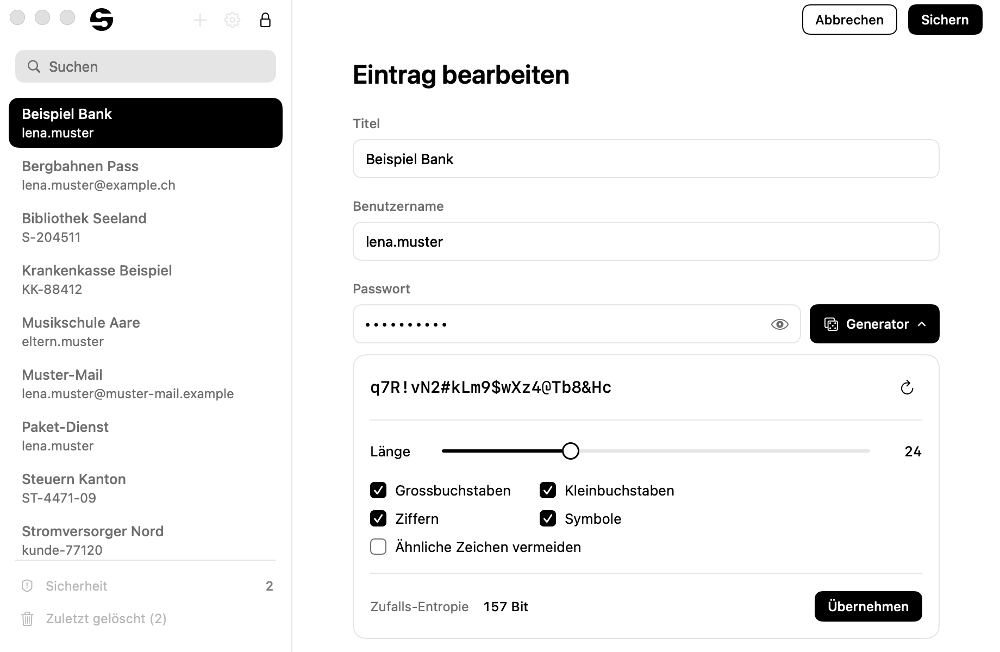
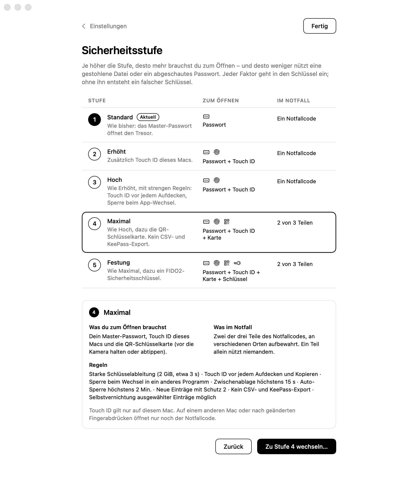
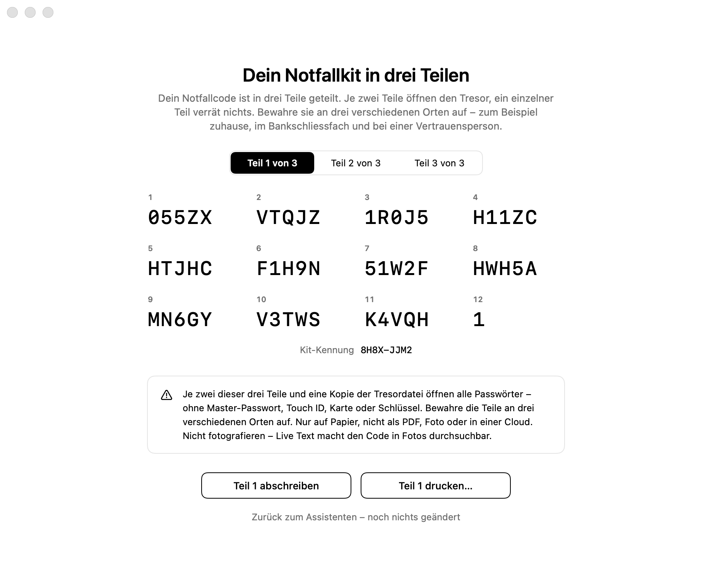

# Siegel

Siegel ist ein nativer Passwort-Manager für macOS (SwiftUI, Apple Silicon, macOS 26+). Er speichert alles in einer
einzigen verschlüsselten Datei auf diesem Mac, ohne Server und ohne Netzwerk. Den Tresor schützen Argon2id und
XChaCha20-Poly1305. Je nach Sicherheitsstufe gehen zusätzlich Touch ID, eine QR-Schlüsselkarte und ein
FIDO2-Sicherheitsschlüssel in den Schlüssel ein. Der Notfallschlüssel ist hybrid mit ML-KEM-1024 und X25519 gebaut,
damit er auch gegen künftige Quantenrechner hält.

Bindend ist `SPEC.md` (v4.6, mit der Selbstvernichtung aus v4.3 und dem Austausch mit Windows aus v4.6). Was Siegel schützt und was nicht, steht in
`SICHERHEIT.md`. Eine englische Übersicht für GitHub steht in `README.md`.

Ehrlich vorweg: Siegel ist ein Einzelprojekt, mit KI-Agenten gebaut und geprüft und **nicht unabhängig auditiert**.
Touch ID, Kamera und Sicherheitsschlüssel sind mit echter Hardware noch nicht durchgeprüft (`PRUEFLISTE.md`, Teil A).

## Bildschirme

Alle 204 Bildschirme liegen als PNG in `snapshots/` (meist 920×600 @2x, nur erfundene Demodaten, auch die gezeigten
Codes). Eine Auswahl:

| Einrichtung | Notfallkit | Gesperrt mit Faktoren |
|---|---|---|
|  |  |  |

| Tresor | Geschützter Eintrag | Bearbeiten mit Generator |
|---|---|---|
|  |  |  |

| Sicherheitsstufen | Notfallkit in drei Teilen | Selbstvernichtung einschalten |
|---|---|---|
|  |  |  |

Die Nummern folgen den Abläufen:

| Nummern | Inhalt |
|---|---|
| 01–12 | Einrichtung und Notfallkit |
| 13–19 | Einstellungen |
| 20–30 | Entsperren und Notfallcode |
| 31–40 | Sonderfälle: Tresor fehlt, beschädigt, Rollback, Signatur, Notfallkit-Blatt |
| 41–59 | Tresor |
| 60–71 | CSV und Sicherungen |
| 80–99 | Sicherheitsstufen, Assistent, Karte, Teile, Entsperren mit Faktoren |
| 100–118 | Schutz pro Eintrag, Sicherheitsschlüssel, Notfallweg mit Teilen, Blätter |
| 119–131 | 2FA-Codes, Sicherheitsbericht, KeePass, Autofill, Lizenzen |
| 132–138 | Sicherungen entfernen, Sperren mit offener Bearbeitung, Notfallweg-Sonderfälle |
| 139–158 | Selbstvernichtung |
| 170–182 | Notfallweg ohne Tresordatei und aus einer gewählten Sicherung |
| 190–193, 230–233 | Prüfungen der zweiten Runde: Sperren, Kamera-Vorschau, markierte Einträge |

`docs/screenshots/` enthält Kopien von sechs Bildern mit englischen Namen für die `README.md`. Werden die Snapshots neu
gerendert, diese Kopien von Hand nachziehen.

## Bauen

Voraussetzungen:

- Mac mit Apple Silicon, macOS 26 oder neuer
- **Xcode 27** unter `/Applications/Xcode.app` (`build.sh` setzt `DEVELOPER_DIR` selbst; für das Icon braucht
  es `actool` aus Xcode)
- **libsodium** liegt fertig im Projekt (`Vendor/Clibsodium.xcframework`, statisch, Version 1.0.22, Herkunft
  und Prüfsumme in `Vendor/LIBSODIUM.txt`). Homebrew ist nur zum **Aktualisieren** nötig:
  `brew install libsodium`, dann `skripte/libsodium_holen.sh`. Das Skript bricht ab, wenn die Version nicht
  1.0.22 ist; eine neue Version zuerst in `SPEC.md` §9 eintragen.
- nur für die Autofill-Variante: XcodeGen (`brew install xcodegen`)

Beim Bauen wird nichts heruntergeladen.

```
./build.sh                                        # bauen, prüfen, nach ~/Applications/Siegel.app installieren
./build.sh run                                    # dasselbe, danach starten
SIEGEL_INSTALL_DIR=/tmp/siegel-probe ./build.sh   # Probe in einen anderen Ordner
```

`build.sh` macht der Reihe nach:

1. **Grep-Sperren** (`skripte/grep_sperren.sh`, zuerst mit Selbsttest): verbotene Muster wie `print(`, `dump`,
   `try!` oder `privacy: .public` in SiegelCore, SiegelUI, SiegelHardware, dem App-Einstieg und der
   Autofill-Erweiterung. Ein kleiner Swift-Lexer blendet Kommentare, Zeichenketten und Regex-Literale aus und
   erkennt auch Umgehungen wie `` `print`(x) ``, `(print)(x)` oder `dump` als Funktionswert.
2. `swift build -c release`.
3. **Bundle** mit `skripte/Info.plist` (darin die Begründung für die Kamera) und Icon (`skripte/icon_bauen.sh`).
   Es kommen nur ausdrücklich genannte Dateien hinein, nie Ressourcenbündel aus dem Bauordner.
4. **Ad-hoc-Signatur** mit Hardened Runtime und genau den sechs Entitlements aus `skripte/Siegel.entitlements`:
   App Sandbox, vom Nutzer gewählte Dateien, Lesezeichen (zweiter Sicherungsort), Drucken (Notfallkit, Karte),
   Kamera (QR-Schlüsselkarte) und USB (Sicherheitsschlüssel). Kein Netzwerk.
5. **Prüfungen** (Abbruch bei jeder Abweichung): `codesign --verify --strict`, genau diese sechs Entitlements und
   kein `get-task-allow`, Flags `adhoc,runtime`, keine Abhängigkeit von libsodium oder `/opt/homebrew`, nur arm64,
   genau die erwarteten Info.plist-Schlüssel und Werte, genauer Bündelinhalt (`Contents/Resources` nur
   `Assets.car` und `Siegel.icns`, keine Test-Fixtures).
6. **Installation** und dieselben Prüfungen an der installierten Kopie. Eine laufende Siegel-Instanz wird vorher
   sauber beendet; ist darin ein Dialog offen, bricht `build.sh` mit einer Meldung ab (kein `kill`).

Mit `SIEGEL_INSTALL_DIR` landet die App in einem anderen Ordner. Dann bleiben `~/Applications/Siegel.app` und eine
laufende Siegel-Instanz unberührt, nichts wird bei LaunchServices angemeldet, und `run` ist gesperrt: Die Kopie hat
dieselbe Bundle-ID und damit denselben Sandbox-Container (denselben Tresor) wie die echte App.

**Starten nur als signierte App** (`./build.sh run` oder danach `~/Applications/Siegel.app`). Ohne Sandbox,
etwa mit `swift run Siegel`, zeigt Siegel nur «Siegel kann so nicht starten». Beim Start prüft Siegel seine eigene
Signatur; ist das Bündel verändert, erscheint «Siegel ist beschädigt», und nichts lässt sich entsperren. Die App ist
ad-hoc signiert und für diesen Mac gebaut, nicht zum Weitergeben (dafür bräuchte es Developer-ID-Signatur und
Notarisierung).

Weitere Prüfwerkzeuge:

| Befehl | Zweck |
|---|---|
| `skripte/sanitizer.sh [address] [thread] [-- --filter …]` | `swift test` mit AddressSanitizer und ThreadSanitizer, je in eigenem Bauordner (`.build/sanitize-*`), Zusammenfassung mit Tests und Funden, Protokolle in `build/sanitizer/`; Laufzeitgrenzen der Tests werden dort gestreckt (`SIEGEL_ZEITFAKTOR`), Exit-Tests schalten sich ab |
| `skripte/fuzz.sh <Minuten> [--nacheinander] [--ziele …] [--saat N]` | Fuzzer `SiegelFuzz` (SPEC §21) im Debug-Bau mit AddressSanitizer: Dateiformat v1/v2, Inhalt, Notfallcode/Teile, QR-Karte, CSV, TOTP, CBOR/CTAPHID samt FIDO2-Abläufen, Hardware-Schlüsseldatei, Sicherungsnamen, Autofill-Abgleich; Rückkopplung über Kanten-Abdeckung; Saat protokolliert, Funde in `build/fuzz/funde/`, Reproduktion mit `--wiederholen`; Ergebnisse in `PRUEFBERICHT.md` |
| `skripte/autofill_bauen.sh` | Autofill-Variante (`Erweiterungen/LIESMICH.md`): ohne `SIEGEL_TEAM_ID` nur Kompilierprüfung, mit Team-ID signierter Bau (nur mit bezahltem Apple-Entwicklerkonto) |
| `referenz/differenz.sh [Anzahl] [Saat]` | Differenztest: Mutanten der Beispieldateien (aus `SiegelFuzz --mutanten`) liest auch die Python-Referenz; keiner darf öffnen, Struktur-Urteile müssen übereinstimmen (bekannte, gewollte Unterschiede werden gezählt) |
| `swift skripte/kontaktbogen.swift` | legt die Snapshots zu je 6 auf Kontaktbögen (`build/kontaktbogen/`) zum Durchsehen |
| `.github/workflows/tests.yml` | CI auf GitHub (macOS 26, Xcode ab 26): Grep-Sperren, `swift test`, Release-Bau, Autofill-Kompilierprüfung |

## Wo die Daten liegen

| Was | Ort |
|---|---|
| Tresor | `~/Library/Containers/com.aralim.siegel/Data/Library/Application Support/Siegel/Tresor.siegel` |
| Automatische Sicherungen | `…/Siegel/Sicherungen/<vaultID>/<UTC-Zeit>-g<Generation>-<Zufall>[-vor-<Anlass>].siegel` |
| Beschädigte Dateien (verschoben, nie gelöscht) | `…/Siegel/Sicherungen/beschaedigt-<Zeit>.siegel` |
| Schlüsseldateien der Faktoren (ab v4) | `…/Siegel/Hardware/<keyID>.siegelhw`: Touch-ID-Schlüssel zum Öffnen und für Einträge, Vernichtungs-Schlüssel. **Nicht** in der Tresordatei und vom Backup ausgenommen |
| Selbstvernichtung (ab v4.3) | `…/Siegel/Hardware/zustand.json` (letzte echte Entsperrung, Fehlversuche, Auslöser; nicht geheim) und die Ablage des Vernichtungs-Passworts (`<UUID>.siegelhw`, 2048 Byte) |
| Zweiter Sicherungsort (empfohlen) | frei wählbar in den Einstellungen, Dateien `Siegel-<vaultID 8 hex>-<UTC-Zeit>.siegel`, höchstens einmal pro Stunde |
| Einstellungen, Rollback-Merker | `~/Library/Containers/com.aralim.siegel/Data/Library/Preferences/` (nur Einstellungen, nie Inhalte) |

Ordner 0700, Dateien 0600. Einstellungen → «Tresor im Finder zeigen» öffnet den Ordner. Die Sicherungen liegen
auf demselben Mac; erst der zweite Sicherungsort (USB-Stick, iCloud Drive) schützt vor dem Verlust des Macs.
Sicherungen werden zeitlich ausgedünnt (48 h alle, dann pro Tag, Woche, Monat). Sicherungen vor heiklen Schritten
(Import, Passwortwechsel, Notfallcode, neues Kit, Wiederherstellung, Stufenwechsel, Umstellung auf Dateiformat 2)
bleiben angeheftet.

**Wichtig ab Stufe 2:** Eine Sicherung ist eine Kopie der Tresordatei und damit an Touch ID **dieses** Macs gebunden,
ab Stufe 4 auch an die Karte bzw. den Schlüssel. Die Touch-ID-Schlüsseldateien gehen weder in Time Machine noch in
eine Sicherung. Auf einem anderen Mac oder nach einem Neuaufsetzen öffnet die Sicherung nur der Notfallcode (Stufen
4/5: zwei der drei Teile).

## Bedienung in Kürze

1. **Einrichtung**: «Passphrase vorschlagen» (6 Wörter, «Neu würfeln») oder ein eigenes Passwort, das die
   Regel erfüllt (geschätzt mindestens 60 Bit, mindestens 12 Zeichen). Zweimal eingeben, «Tresor anlegen».
   Ist FileVault aus, erscheint ein Hinweis. Ein neuer Tresor startet in Stufe 1.
2. **Notfallkit**: Code «Von Hand abschreiben» oder «Drucken…» (ohne Vorschau, mit Warnung bei
   unverschlüsselten Netzwerkdruckern; als PDF gibt Siegel den Code nicht aus), danach zwei zufällig gewählte Gruppen
   eintippen. Bis dahin steht im Tresor «Notfallkit nicht bestätigt – jetzt einrichten». Nur auf Papier aufbewahren
   (`SICHERHEIT.md` §6).
3. **Entsperren**: Master-Passwort, Enter, danach die Faktoren der Stufe (siehe unten). Unter dem Feld zeigt Siegel,
   was zum Öffnen nötig ist und was schon bestätigt ist. «Notfallcode verwenden» führt zum Notfallweg.
4. **Tresor**: Liste links (Suche nur über Titel, Benutzername und Website), Detail rechts. Kopieren legt den
   Wert für 30 s in die Zwischenablage (einstellbar), das Auge deckt das Passwort auf, «Website öffnen» nur für
   http/https, «Frühere Passwörter» zeigt den Verlauf. Bearbeiten mit eingebautem Generator; «Übernehmen» speichert
   sofort. Löschen verschiebt nach «Zuletzt gelöscht» (30 Tage).
5. **Einstellungen** (⌘,, nur entsperrt), in Abschnitten:
   - **Sicherheitsstufe**: Stufe, Schutz neuer Einträge, Faktoren für Einträge, Selbstvernichtung
   - **Sperren**: Auto-Sperre (1/5/15/30 Min), Zwischenablage leeren (15/30/60/90 s), Geheimnisse auf externen
     Bildschirmen
   - **Master-Passwort**: ändern, Schlüsselableitung Standard/Stark
   - **Notfallkit**: Kit-Kennung, «Notfallcode prüfen…», «Neues Notfallkit…»
   - **Sicherungen**: zweiter Sicherungsort, verschlüsselte Sicherung exportieren oder einspielen, ältere
     Sicherungen entfernen, Tresor im Finder zeigen
   - **Import und Export**: CSV importieren (Apple Passwörter, Chrome, Firefox, Bitwarden), CSV exportieren, KeePass
     exportieren
   - **Automatisches Ausfüllen**, **Sicherheit** (Verfahren, FileVault-Status), **Info** (Version, Lizenzen)

   Heikle Aktionen fragen das Master-Passwort und die Faktoren der Stufe erneut ab.
6. **Sonderfälle**: «Tresor fehlt» (aus Sicherung wiederherstellen, auch mit dem Notfallkit: «Passwort
   vergessen? Notfallcode verwenden»), «Tresordatei beschädigt» (neueste lesbare Sicherung öffnen, Sicherung aus
   Datei einspielen oder «Notfallcode verwenden»), «Trotzdem öffnen?» (Datei älter als zuletzt gesehen), «Siegel läuft
   bereits», «Neuere Siegel-Version nötig».

## Sicherheitsstufen

Die Stufe bestimmt, was du zum **Öffnen des Tresors** brauchst. Jeder Faktor geht als Geheimnis in den Schlüssel ein:
Fehlt er, entsteht ein falscher Schlüssel, und es gibt keine Tür daran vorbei.

| Stufe | Zum Öffnen | Im Notfall | Regeln |
|---|---|---|---|
| 1 Standard | Master-Passwort | ein Notfallcode | wie bisher |
| 2 Erhöht | Passwort + Touch ID | ein Notfallcode | wie bisher |
| 3 Hoch | Passwort + Touch ID | ein Notfallcode | Schlüsselableitung «Stark» (2 GiB, etwa 3 s), Touch ID vor jedem Aufdecken und Kopieren, Sperre beim Wechsel in ein anderes Programm, Zwischenablage höchstens 15 s, Auto-Sperre höchstens 2 Min. |
| 4 Maximal | Passwort + Touch ID + QR-Schlüsselkarte | zwei von drei Teilen | wie 3, neue Einträge mit Schutz 2, kein CSV- und KeePass-Export, Selbstvernichtung möglich |
| 5 Festung | Passwort + Touch ID + Karte + Sicherheitsschlüssel (FIDO2) | zwei von drei Teilen | wie 4 |

**Stufe erhöhen**: Einstellungen → Sicherheitsstufe → «Ändern…». Die Übersicht zeigt pro Stufe, was du zum Öffnen
brauchst und was im Notfall. «Zu Stufe x wechseln…» startet den Assistenten, zum Beispiel von 1 auf 4 in sechs
Schritten:

1. Vergleich bisher/danach.
2. Master-Passwort.
3. Touch ID einrichten (einmal Finger auflegen zur Prüfung).
4. Karte drucken oder von Hand abschreiben und einmal scannen bzw. abtippen.
5. Notfallkit in drei Teilen erstellen, jeden Teil drucken oder abschreiben, danach je Teil eine Gruppe bestätigen.
6. Zusammenfassung → «Stufe wechseln».

Bis zum letzten Schritt ändert sich nichts. Danach verschlüsselt Siegel alles neu (neuer Tresorschlüssel, neues Salz)
und legt vorher eine angeheftete Sicherung an. Zum Schluss fragt Siegel «Alte Sicherungen … Entfernen?». Die
bisherigen Sicherungen öffnen mit dem alten Zugang, also ohne die neuen Faktoren. Darum ist «Entfernen» meist richtig.

**Stufe senken**: gleicher Weg, verlangt alle Faktoren der aktuellen Stufe. Nicht mehr gebrauchte Touch-ID-Schlüssel
entfernt Siegel erst nach dem erfolgreichen Schreiben. Von Stufe 4/5 auf 1–3 braucht es ein neues Notfallkit (ein
einzelner Code statt drei Teile). Ist die Selbstvernichtung eingerichtet, lässt sich nicht unter Stufe 4 senken; die
Stufenwahl sagt dann «Schalte zuerst die Selbstvernichtung aus».

## Faktoren

- **Touch ID** (ab Stufe 2): Siegel legt in der Secure Enclave dieses Macs einen Schlüssel an. Er verlässt den Mac
  nie, nur dein Finger gibt ihn frei. Touch ID wird jedes Mal neu verlangt.
  - **Achtung:** Der Schlüssel gilt nur für die jetzt eingerichteten Fingerabdrücke. Wer in den Systemeinstellungen
    einen Fingerabdruck hinzufügt oder entfernt, macht ihn unbrauchbar. Danach öffnet nur noch der Notfallcode, und
    vernichtbare Einträge sind verloren (`SICHERHEIT.md` §12).
  - Ist Touch ID nur gesperrt (zu viele Fehlversuche) oder nicht erreichbar (Deckel zu, Tastatur mit Touch ID nicht
    verbunden), hilft «Erneut versuchen», nachdem du den Mac mit dem Passwort entsperrt bzw. den Deckel geöffnet hast.
    Einen Notfallweg braucht es dafür nicht.
- **QR-Schlüsselkarte** (ab Stufe 4):
  - Die Karte trägt 256 Bit Zufall als QR-Code, daneben denselben Code in 11 Gruppen zum Abtippen.
  - «Karte drucken…» (ohne Vorschau, mit Druckerwarnung, als PDF ohne Code) oder «Code von Hand abschreiben», danach
    einmal scannen bzw. abtippen. Erst dann wird etwas geschrieben.
  - Beim Öffnen hältst du die Karte etwa 20 cm vor die eingebaute Kamera oder wählst «Code von der Karte abtippen».
    Die Kamera läuft nur bei Bedarf, Bilder werden nie gespeichert. Auf externen Bildschirmen ist die
    Kamera-Vorschau verdeckt, die Erkennung läuft trotzdem.
  - Eine falsche Karte erkennt Siegel, bevor gerechnet wird.
  - Die Karte getrennt vom Mac aufbewahren, nicht fotografieren.
- **Sicherheitsschlüssel** (Stufe 5): ein FIDO2-Schlüssel mit hmac-secret über USB (z. B. YubiKey 5). Siegel
  registriert ihn einmal (berühren, sobald er blinkt, 30 s Frist) und fragt ihn bei jedem Öffnen ab. Sind mehrere
  angeschlossen, wählst du einen. Schlüssel, die fürs Registrieren eine PIN oder Benutzerprüfung verlangen, lassen
  sich nicht einrichten. **Mit echter Hardware ungetestet**, die Oberfläche sagt es auch.
- **Faktoren nur für Einträge**: Auch in Stufe 1–3 lassen sich Touch ID, Karte und Schlüssel nur für den Schutz pro
  Eintrag einrichten: Einstellungen → «Faktoren für Einträge» → Einrichten, oder in der Bearbeitung neben einem
  Schutz mit «noch einrichten» → «Jetzt einrichten…» (danach «Zurück zum Eintrag»). Dieselbe Karte bzw. derselbe
  Schlüssel dient später auch dem Öffnen. Ein Faktor, an dem versiegelte Einträge hängen, lässt sich nicht ersetzen.

## Schutz pro Eintrag

Die Stufe schützt den ganzen Tresor. Der **Schutz** schützt zusätzlich die **Geheimteile eines Eintrags** (Passwort,
Notizen, frühere Passwörter, 2FA-Geheimnis). Sie sind eigens versiegelt und nur mit den Faktoren lesbar, nicht nur
in der Oberfläche versteckt.

| Schutz | Bei jedem Aufdecken, Kopieren, Bearbeiten zusätzlich | Regeln |
|---|---|---|
| 1 Normal | nichts (der offene Tresor genügt) | wie der Tresor |
| 2 Fingerabdruck | Touch ID | – |
| 3 Hoch | Touch ID | Zwischenablage höchstens 15 s, nie Autofill |
| 4 Maximal | Touch ID + Karte scannen | wie 3, nicht im CSV- und KeePass-Export |
| 5 Festung | Touch ID + Karte + Sicherheitsschlüssel berühren | wie 4 |

- **Setzen**: Bearbeiten (⌘E) → Abschnitt «Schutz». Fehlt ein Faktor, steht «noch einrichten» daneben. Die Vorgabe
  für neue Einträge stellst du unter Einstellungen → «Schutz neuer Einträge» ein; Stufe 4/5 verlangt mindestens
  Schutz 2.
- **Aufdecken**: Ein geschützter Eintrag zeigt «Geschützt» mit «Aufdecken». Siegel fragt nacheinander Touch ID, Karte
  und Schlüssel ab, bei **jedem** Aufdecken neu. Danach steht «Aufgedeckt», bis du den Eintrag wechselst, «Verbergen»
  wählst oder sperrst. Nichts davon wird zwischengespeichert.
- **Ändern** (auch senken): zuerst die Geheimteile aufdecken. Die Bearbeitung sagt das.
- **Ohne Faktoren** gehen Liste, Suche, Titel, Benutzername und Website sowie der Sicherheitsbericht.
- **Einmal pro Gruppe**: Ein neues Notfallkit, ein Stufenwechsel mit neuem Kit, Exporte und das Einschalten der
  Selbstvernichtung fragen die Faktoren einmal pro Gruppe gleich geschützter Einträge ab, nicht pro Eintrag.
- **Stufe 3–5 und Schutz 1**: Auch Einträge mit Schutz 1 verlangen Touch ID vor dem Aufdecken. Das ist eine Regel
  der Oberfläche; kryptografisch geschützt ist erst Schutz 2 (`SICHERHEIT.md` §10).
- **Sperren während der Bearbeitung** eines geschützten Eintrags speichert nur versiegelt. Fehlt für den gewählten
  Schutz noch ein Faktor, gilt der höchste eingerichtete, und der Sperrbildschirm sagt es.

## Selbstvernichtung

Nur in Stufe 4/5 und nur für **ausgewählte Einträge mit Schutz 4/5** («vernichtbar»). Vernichtet werden deren
Passwort, Notizen, frühere Passwörter und 2FA-Geheimnis. Der Tresor und alle anderen Einträge bleiben, wie sie sind.
**Vernichtbare Einträge haben keinen Notfallweg**, auch der Notfallcode öffnet sie nicht. Zuerst mit einem
Testtresor ausprobieren (`PRUEFLISTE.md`, Teil A).

**Einschalten**: Einstellungen → Sicherheitsstufe → «Selbstvernichtung».

1. Einträge auswählen. Einträge mit tieferem Schutz erscheinen nicht; ihren Schutz erhöhst du beim Bearbeiten.
2. Auslöser wählen:
   - **Totmann-Schalter**: 7, 14, 30, 90, 180 oder 365 Tage ohne echtes Entsperren. Siegel prüft beim Start, beim
     Aktivieren und alle 10 Minuten, auch gesperrt. Ab einem Viertel Restzeit zeigt der Sperrbildschirm «Frist endet
     am …».
   - **Fehlversuch-Zähler**: nach 10, 20, 30, 50 oder 100 falschen Passwörtern in Folge. Ab der Hälfte steht «Noch x
     Versuche bis zur Vernichtung». Deine eigenen Tippfehler zählen mit, auch beim Wiederherstellen einer Sicherung.
   - **Vernichtungs-Passwort**: ein zweites Passwort für den Fall, dass du eines nennen musst. Es öffnet den Tresor
     scheinbar normal (gleiche Faktoren, gleiche Dauer) und vernichtet vorher still die markierten Einträge. Es muss
     die Passwort-Regel erfüllen und sich vom Master-Passwort unterscheiden.
3. «Weiter…» → Übersicht → **VERNICHTEN** eintippen → Master-Passwort → Touch ID und Karte. Danach einmal Touch ID für
   den eigenen Vernichtungs-Schlüssel und die Faktoren der betroffenen Einträge zum Neu-Versiegeln → «Einschalten».

Beim Markieren entfernt Siegel alle älteren eigenen Sicherungen, denn sie enthielten die Einträge noch mit Notfallweg.
Time-Machine-Kopien von vorher erreicht Siegel nicht.

**Nach einer Vernichtung** zeigt das nächste Entsperren mit dem Master-Passwort «n Einträge wurden vernichtet» mit
Auslöser und Datum. Die Einträge stehen mit «Vernichtet» in der Liste, «Entfernen» räumt sie weg. Danach ist die
Selbstvernichtung ganz aus und muss neu eingerichtet werden. Nach einer Sitzung mit dem Vernichtungs-Passwort
erneuert das nächste echte Entsperren zuerst den Tresorschlüssel (dauert einmal etwas länger).

**Ausschalten**: «Alles ausschalten» auf derselben Seite (Master-Passwort und Faktoren). Ohne Auslöser vernichtet
Siegel nichts; markierte Einträge haben aber trotzdem keinen Notfallweg, bis du sie abwählst. Die Einstellungen zeigen
dann «Einträge markiert · kein Auslöser».

## Notfall

**Master-Passwort vergessen oder Faktor verloren** (Touch-ID-Schlüssel ungültig, Karte oder Sicherheitsschlüssel
weg):

1. Sperrbildschirm → «Notfallcode verwenden».
2. Stufen 1–3: den Code mit 11 Gruppen abtippen. Stufen 4/5: zwei beliebige der drei Teile (je 12 Gruppen). Ein
   einzelner Teil verrät nichts. Unleserliche Zeichen gibst du als `?` ein (bis zu vier). Siegel schlägt bei ein oder
   zwei Tippfehlern bzw. vertauschten Nachbarn eine Korrektur mit markierten Stellen vor («Stimmen diese Teile?»).
3. Neues Master-Passwort zweimal eingeben → «Tresor wiederherstellen».
4. Siegel zeigt Eintragszahl und letzte Änderung: Inhalt prüfen.

Der Notfallcode ersetzt Passwort **und** alle Faktoren. Danach gilt **Stufe 1, alle Einträge haben Schutz 1**, und
vernichtbare Einträge fallen weg (Siegel warnt vorher). Stufe und Faktoren richtest du unter Einstellungen →
Sicherheitsstufe neu ein. Touch ID nur gesperrt oder Deckel zu ist **kein** Notfall (siehe Faktoren).

**Tresordatei fehlt oder ist beschädigt**: «Tresor fehlt» listet die Sicherungen; mit dem Master-Passwort der
Sicherung wiederherstellen, oder «Passwort vergessen? Notfallcode verwenden» bzw. «Andere Sicherung wählen…».
«Tresordatei beschädigt» bietet «Neueste lesbare Sicherung öffnen», «Sicherung aus Datei einspielen…» und den
Notfallcode. Die beschädigte Datei bleibt unter «Sicherungen» erhalten.

**Neuer Mac** (alter Mac defekt oder gestohlen): Siegel installieren und in der Einrichtung «Aus Sicherung
wiederherstellen…» wählen, die Sicherung vom zweiten Sicherungsort (z. B. USB-Stick) öffnen.

- **Stufe 1**: das Master-Passwort genügt.
- **Ab Stufe 2**: Der Touch-ID-Schlüssel gilt nur auf dem alten Mac. Darum «Passwort vergessen? Notfallcode
  verwenden» und den Notfallcode (Stufen 4/5: zwei der drei Teile) abtippen. Siegel setzt die Sicherung mit einem
  neuen Master-Passwort in Stufe 1 ein.

Denselben Weg gibt es unter Einstellungen → «Sicherung einspielen…», z. B. für Sicherungen von vor einer Abstufung:
Lässt sich ein Faktor nicht verwenden, bietet Siegel «Notfallcode verwenden» für genau diese Datei an.

**Notfallkit pflegen**:

- Einstellungen → «Notfallcode prüfen…» prüft Code bzw. zwei Teile, ohne etwas zu ändern. Das ab und zu machen.
- «Neues Notfallkit…», wenn ein Blatt verloren ging oder gesehen wurde, auch wenn nur ein Teil von dreien fehlt.
  Der alte Code bleibt gültig, bis das neue Kit bestätigt ist. Danach die Frage «Bisherige Sicherungen entfernen?»
  mit «Entfernen» beantworten.
- Gehen Passwort, Faktoren **und** Notfallkit verloren, ist der Tresor verloren. Es gibt keine Hintertür.

## Weitere Funktionen

- **2FA-Codes**: Im Feld «2FA-Geheimnis (optional)» ein `otpauth://totp/…`-Link oder das Base32-Geheimnis; das Detail
  zeigt den Code mit Restsekunden. 2FA im selben Tresor heisst: Wer den Tresor öffnet, hat auch den zweiten Faktor.
- **Sicherheitsbericht**: Seitenleiste «Sicherheit». Er zeigt schwache, wiederverwendete und über ein Jahr alte
  Passwörter sowie solche, die gleich wie das Master-Passwort sind. Er arbeitet offline, auch für geschützte
  Einträge, ohne sie aufzudecken, und gleicht nichts mit Listen gestohlener Passwörter ab.
- **KeePass exportieren** (Stufen 1–3): KDBX 4.1 mit eigenem Export-Passwort, in einen Ordner, den Spotlight und Time
  Machine auslassen. Ohne frühere Passwörter und ohne Einträge mit Schutz 4/5.
- **Automatisches Ausfüllen**: vorbereitet, aber nicht aktiv. Die Erweiterung braucht ein bezahltes
  Apple-Entwicklerkonto (`Erweiterungen/LIESMICH.md`).

Tastenkürzel:

| Kürzel | Wirkung |
|---|---|
| ⌘N | Neuer Eintrag |
| ⌘F | Suchen |
| ↑ ↓ / Enter | in der Liste wählen / gewählten Eintrag bearbeiten |
| ⌘E | Bearbeiten |
| ⌘S | beim Bearbeiten sichern |
| Esc | Bearbeiten abbrechen, Suche leeren |
| ⇧⌘C | Passwort des gewählten Eintrags kopieren (bei Schutz ≥ 2 mit Faktoren) |
| ⌘L | Sperren |
| ⌘, | Einstellungen (nur entsperrt) |
| ⌘Q | Beenden (eine offene Bearbeitung wird vorher gespeichert) |

## Tests

```
export DEVELOPER_DIR=/Applications/Xcode.app/Contents/Developer
swift test                                   # alle Tests (swift-testing): SiegelCoreTests, SiegelHardwareTests,
                                             # SiegelAutofillTests
swift build -c release --product SiegelSnapshots && .build/release/SiegelSnapshots snapshots
                                             # alle 204 Bildschirme neu rendern und Abläufe prüfen
swift skripte/kontaktbogen.swift             # Kontaktbögen (je 6 Bilder) in build/kontaktbogen/ zum Durchsehen
referenz/gegenprobe.sh                       # Python-Referenz gegen v1/v2_beispiel.siegel und die C#-Dateien
skripte/sanitizer.sh                         # swift test mit ASan und TSan
skripte/fuzz.sh 20                           # Fuzzer, alle Ziele parallel je 20 min (Bericht: PRUEFBERICHT.md)
skripte/autofill_bauen.sh                    # Autofill-Variante, ohne Team-ID nur Kompilierprüfung
```

Stand 17.10.2026 abends (`PRUEFBERICHT.md`): 496 Tests grün, ASan und TSan ohne Meldung, 20.4 Fuzz-Stunden mit
221.9 Mio. Eingaben in 12 Zielen (seit Runde 3 mit Selbstvernichtung: beim Aufbau 8 Fehler im Produktcode gefunden
und behoben, im Langlauf danach kein Fund), Python-Gegenprobe und Differenztest ohne Abweichung.

- Die Tests mit echten Argon2-Profilen (256 MiB bis 2 GiB) laufen nacheinander (`.serialized`) und brauchen
  entsprechend Zeit; die übrigen nutzen einen Testschalter, der nur im Debug-Bau existiert.
- `Tests/SiegelCoreTests/Fixtures/` enthält eingefrorene Testvektoren und die Beispieldateien
  `v1_beispiel.siegel` und `v2_beispiel.siegel` (Stufe 5), die jede künftige Version über beide Wege öffnen muss.
  **Nie ändern** (siehe dortige `README.md`).
- Tabelle der 30 typischen Passwörter: `SIEGEL_STAERKE_TABELLE=1 swift test --filter StaerkeTypischTests`.
- Snapshots: Das Programm löscht vorher die PNGs im Zielordner, arbeitet nur mit Temp-Ordnern und dem echten
  Kern (1 GiB Argon2) und endet mit Exit-Code 1, wenn eine Ablauf-Prüfung scheitert. Touch ID, Kamera und
  Sicherheitsschlüssel ersetzt dort eine Attrappe (`DemoHardware`), nie ein echter Dialog.
- Python-Referenz (`referenz/`, SPEC §21): unabhängige Leser für `.siegel` v1/v2 und KDBX, nur aus `SPEC.md`
  geschrieben; `ReferenzTests` vergleicht Swift und Python automatisch, wenn Python 3.12 und Homebrew-libsodium
  vorhanden sind. Den Notfallweg kann sie nicht nachrechnen (ML-KEM fehlt in Python und libsodium).
- Wortlisten neu erzeugen: `python3 skripte/woerter/listen_bauen.py` (nur Standardbibliothek, kein Netz). Danach auch
  die Windows-Kopie: `python3 windows/skripte/listen_exportieren.py` und `python3 windows/skripte/korpus_erzeugen.py`.
- Windows-Version (seit 18.10.2026, Etappe 1: Kern und Werkzeuge in C#, noch ohne Oberfläche): `windows/LIESMICH-WINDOWS.md`.
  `Tests/SiegelCoreTests/Interop/` öffnet die vom C#-Kern geschriebenen Dateien (`windows/tests/Fixtures/`); Tresore,
  deren Eintrags-Gerätefaktor unter Windows eingerichtet wurde (Windows Hello), öffnet der Mac ab v4.6 und behandelt
  diese Einträge als „anderes Gerät“ (SPEC §12 v4.6).
- Logo und Icon-Ebene neu erzeugen: in `design/` `python3 bauen.py` (Masse nur dort ändern).

## Prüfliste

Was sich nicht automatisch prüfen lässt, steht in `PRUEFLISTE.md`:

- **Teil A**, zuerst und zu zweit: Touch ID, Karte drucken und scannen, Stufe wechseln, Schutz pro Eintrag,
  Selbstvernichtung, Notfallweg.
- **Teil B**: Fensterschutz, Zwischenablage, Bildschirme, Felder, Bedienungshilfen, Drucken, Sicherungen, Sperren,
  Sandbox, Icon.
- **Teil C**: mit zusätzlicher Hardware oder zusätzlichem Konto.

Vor jeder Weitergabe und nach Änderungen an Fenstern, Feldern, Zwischenablage oder Drucken einmal durchgehen, nur mit
einem Testtresor. Hilfsmittel: `swift skripte/fenster_pruefen.swift`, `swift skripte/ax_pruefen.swift`.

## Projektstruktur

```
siegel/
├── README.md                englische Übersicht für GitHub
├── LIESMICH.md              diese Datei
├── SPEC.md                  Spezifikation v4.6 (bindend)
├── SICHERHEIT.md            Bedrohungsmodell, Verfahren, Grenzen, Aussperr-Risiken (für Laien)
├── LIZENZEN.md              Drittkomponenten und Lizenztexte
├── PRUEFLISTE.md            manuelle Prüfungen (Teil A zuerst)
├── PRUEFBERICHT.md          Ergebnisse von Fuzzer, Sanitizer, Python-Gegenprobe
├── Package.swift            SwiftPM, swift-tools 6.2, macOS 26
├── build.sh                 Bau, Signatur, Prüfungen, Installation
├── Sources/
│   ├── SiegelCore/          Kern ohne Oberfläche
│   │   ├── Kern/            Kryptografie, Dateiformat v1/v2, Faktoren, Stufen, Shamir, Eintrags-Schutz,
│   │   │                    Selbstvernichtung, Bericht, Speichern, Sicherungen, Rollback, Notfallcode (KERN-NOTIZEN.md)
│   │   ├── Staerke/         zxcvbn-Schätzung, Master-Passwort-Regel, Passphrase, Woerter/ (generierte Listen, HERKUNFT.md)
│   │   └── Werkzeuge/       Passwort-Generator, CSV-Import/-Export, TOTP, KeePass-Export, AutofillMatcher
│   ├── SiegelHardware/      Secure Enclave, QR-Karte (Bild, Kamera), FIDO2 über USB-HID, Signaturprüfung
│   │                        (HARDWARE-NOTIZEN.md)
│   ├── SiegelUI/            SwiftUI-Oberfläche und App-Modell (Bildschirme/, Tresor/, Felder/, Haertung/,
│   │                        Modell/, Theme/, Drucken/); Architektur in UI-NOTIZEN.md
│   ├── Siegel/              ausführbares Ziel, nur @main
│   ├── SiegelSnapshots/     rendert alle Bildschirme offscreen als PNG
│   ├── SiegelFuzz/          Fuzzer (nur Debug-Bau, skripte/fuzz.sh; Ziele und Invarianten in FUZZ-NOTIZEN.md)
│   ├── SiegelStaerkeExport/ Stärke-Referenz für die Windows-Version (nur Debug, aufgerufen von windows/skripte/)
│   └── SiegelFuzzAbdeckung/ Kanten-Abdeckung für den Fuzzer (C)
├── Tests/SiegelCoreTests/   Kern/, Staerke/, Werkzeuge/, Integration/, Interop/ (C#-Dateien), Fixtures/ (eingefroren)
├── Tests/SiegelHardwareTests/  Software-Secure-Enclave, virtueller FIDO2-Authenticator, CBOR/CTAPHID, QR, Fuzz
├── Tests/SiegelAutofillTests/  Abläufe der Autofill-Erweiterung (Paket-Ziel SiegelAutofillErweiterung, gleiche Quellen)
├── referenz/                Python-Referenz (siegel_referenz.py, gegenprobe.sh, differenz.sh, erwartete Werte)
├── windows/                 Windows-Version (C#/.NET 10): SPEC-WINDOWS.md, LIESMICH-WINDOWS.md, src/, tests/, skripte/
├── Erweiterungen/           Autofill-Erweiterung + XcodeGen-Projekt (nur mit bezahltem Entwicklerkonto)
├── .github/workflows/       CI (tests.yml)
├── Vendor/                  Clibsodium.xcframework, LIBSODIUM.txt, LIBSODIUM-LICENSE.txt
├── skripte/                 libsodium_holen.sh, icon_bauen.sh, grep_sperren.sh, fenster_pruefen.swift,
│                            ax_pruefen.swift, svg_render.swift, kontaktbogen.swift, sanitizer.sh, fuzz.sh,
│                            autofill_bauen.sh,
│                            Info.plist, Siegel.entitlements, woerter/ (Quellen und listen_bauen.py)
├── design/                  Logo «Schlüssel-S» (bauen.py = Quelle, LOGO.md), Icon-Ebene, Entwürfe, Wettbewerb
├── docs/screenshots/        sechs Bilder für README.md (Kopien aus snapshots/)
├── snapshots/               204 Bildschirmbilder
├── build/                   Bauprodukte von build.sh (nicht im Repo)
└── .build/                  SwiftPM-Zwischenstände (nicht im Repo)
```

## Lizenzen

Siegel nutzt libsodium (ISC), Wortlisten aus zxcvbn (MIT), `/usr/share/dict/web2` (gemeinfrei) und Apples
System-Frameworks. Texte und Pflichten: `LIZENZEN.md`. Für Siegel selbst ist noch keine Lizenz festgelegt
(Info.plist: «© 2026 Aralim»).
