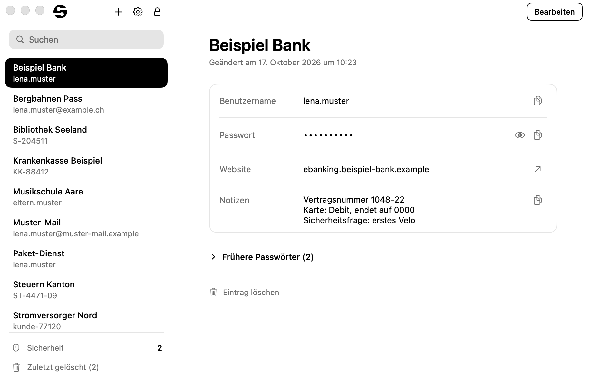
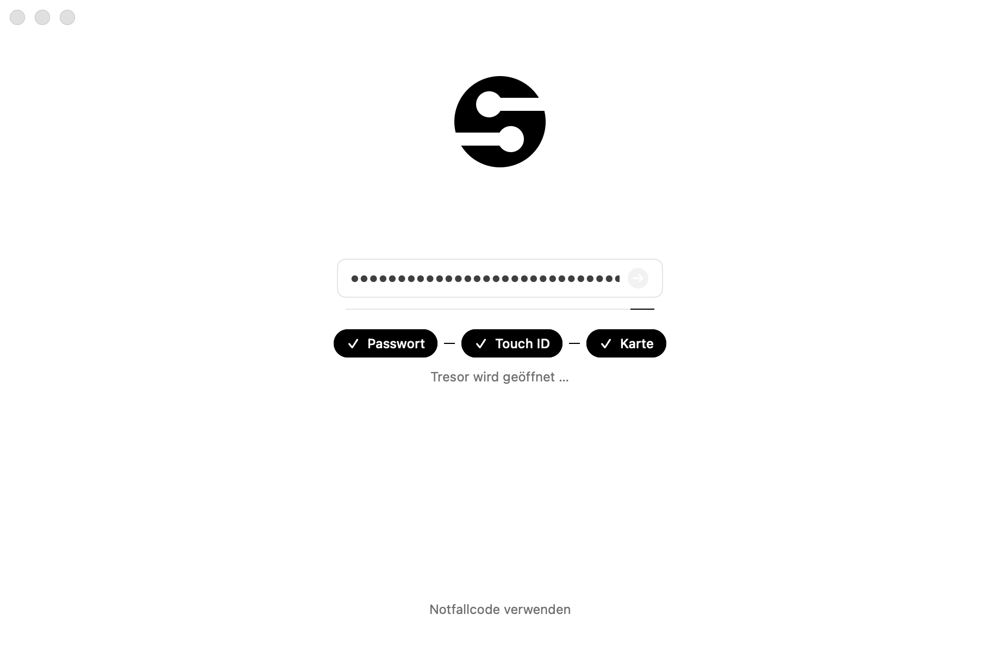
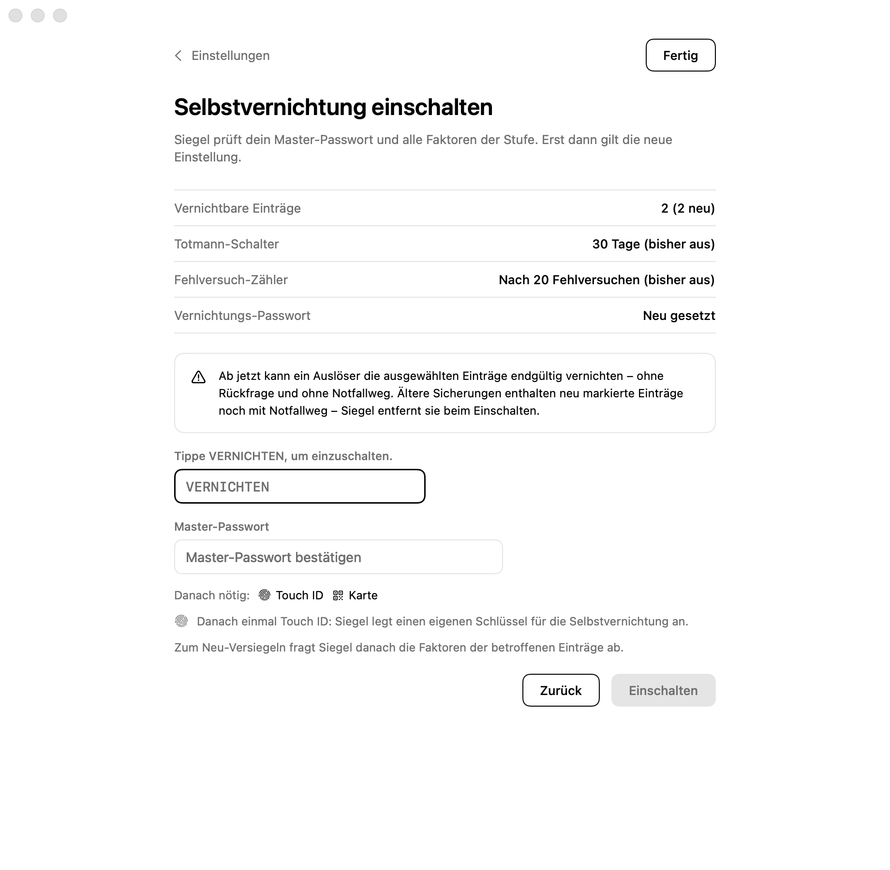
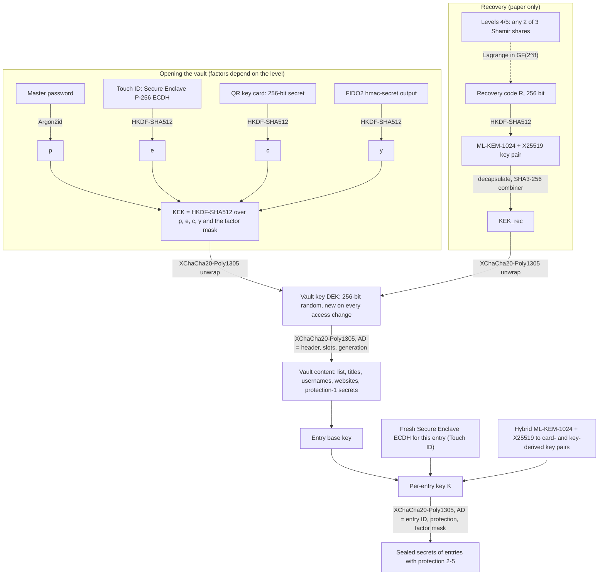

<p align="center">
  
</p>

<h1 align="center">Siegel</h1>

<p align="center">
  A native macOS password manager that keeps your vault in a single locally encrypted file, with no server and no
  network, optional Touch ID, QR key card and FIDO2 factors, and a post-quantum hybrid recovery key.
</p>

<p align="center">
  <a href="LIESMICH.md">Deutsch: LIESMICH.md</a> ·
  <a href="SICHERHEIT.md">Security notes (German)</a> ·
  <a href="SPEC.md">Specification (German)</a> ·
  <a href="PRUEFBERICHT.md">Test report (German)</a>
</p>

> [!WARNING]
> **Project status.** Siegel is a showcase and research project, **not audited**. One developer built and reviewed
> it with AI coding agents. The cryptographic building blocks are standard (libsodium, Apple CryptoKit), but the
> way they are put together has not been reviewed by an independent cryptographer. Builds are ad-hoc signed for the
> developer's own Mac; there are no releases. Please read the [threat model](#threat-model) before trusting it with
> real secrets.

## Screenshots

The interface is in German (Swiss spelling). All screens are rendered offscreen by the `SiegelSnapshots` target
with invented demo data (including the codes shown). All 204 screens are in [`snapshots/`](snapshots/).

<table>
  <tr>
    <td width="50%"></td>
    <td width="50%"></td>
  </tr>
  <tr>
    <td><b>Vault.</b> Calm monochrome window. Secrets stay hidden, copying clears the clipboard after a set time.</td>
    <td><b>Unlock with factors.</b> At level 4 the vault key needs the password, Touch ID and the QR key card.</td>
  </tr>
  <tr>
    <td></td>
    <td></td>
  </tr>
  <tr>
    <td><b>Five security levels.</b> Each level lists what you need to open the vault and what you need if you lose access.</td>
    <td><b>Per-entry protection.</b> This entry's secrets need Touch ID and the key card every time they are revealed.</td>
  </tr>
  <tr>
    <td></td>
    <td></td>
  </tr>
  <tr>
    <td><b>Recovery kit in three shares.</b> At levels 4 and 5 any two of three paper shares restore the vault.</td>
    <td><b>Self-destruction (opt-in).</b> Turning it on requires typing VERNICHTEN, the master password and every factor.</td>
  </tr>
</table>

## Features

**Five security levels.** Each factor adds 32 secret bytes to the key derivation. If a factor is missing or wrong,
the derived key is wrong. No button or code path in the UI can open the vault without it.

| Level | To open the vault | Recovery | Additional rules |
|---|---|---|---|
| 1 Standard | master password | one recovery code | – |
| 2 Elevated (*Erhöht*) | password + Touch ID | one recovery code | – |
| 3 High (*Hoch*) | password + Touch ID | one recovery code | stronger Argon2id profile; UI rules: Touch ID before every reveal or copy, lock when switching apps, clipboard ≤ 15 s, auto-lock ≤ 2 min |
| 4 Maximum (*Maximal*) | password + Touch ID + QR key card | 2 of 3 shares | as level 3, new entries get protection 2, no CSV/KeePass export |
| 5 Fortress (*Festung*) | password + Touch ID + key card + FIDO2 security key | 2 of 3 shares | as level 4 |

You change levels in a guided wizard. Nothing is written until the last step. Every level change rotates the vault key
and the KDF salt.

**Factors.**
- *Touch ID*: a P-256 key in the Secure Enclave, protected with `.biometryCurrentSet`. Its key blob lives in the app
  container and is never part of the vault file or its backups. From level 2 up, a stolen vault file cannot be
  attacked by guessing the password alone.
- *QR key card*: a 256-bit random secret on a printed card. Siegel prints it without a preview and warns about
  network printers. You confirm it once by scanning or typing it. To unlock, you hold it in front of the built-in
  camera (Vision reads it, frames are never stored) or type the code.
- *FIDO2 security key*: Siegel's own CTAP2 implementation over USB HID, using the `hmac-secret` extension. It is
  tested against a virtual CTAP 2.1 authenticator and fuzzed, but **not yet tested with a real device**. The UI says
  so as well.

**Per-entry protection (levels 1–5).** Separately from the vault level, each entry can require Touch ID, the key card
and/or the security key every time its secrets (password, notes, password history, TOTP secret) are revealed, copied
or edited. This is enforced cryptographically, not just in the UI. The secrets are sealed under a per-entry key that
combines a fresh Secure Enclave ECDH (one ephemeral key per entry) with hybrid ML-KEM-1024 + X25519 encapsulations
to key pairs derived from the card and the security key. The list, search, titles, usernames and websites work
without factors, and nothing revealed is cached.

**Post-quantum hybrid recovery key.** The recovery code holds 256 random bits, written as 55 Crockford Base32
characters in 11 groups with a checksum and a kit ID. Siegel corrects up to two wrong characters, swapped neighbors
or four characters marked unreadable. The code derives an ML-KEM-1024 (FIPS 203) + X25519 key pair, and only the
public keys are stored. When the vault key rotates, Siegel encapsulates it again without knowing the code, so a
printed kit stays valid. The code is printed only on a real printer. "Save as PDF" gets a placeholder instead.

**Shamir 2-of-3.** At levels 4 and 5 the recovery code is split byte-wise over GF(2^8) into three printed shares. Any
two restore the vault, and one share alone reveals nothing.

**Self-destruction (opt-in, levels 4/5).** Applies only to selected entries with protection 4/5. There are three
triggers:
- a dead man's switch (7–365 days without a genuine unlock)
- a failed-attempt counter (10–100)
- a duress password that opens the vault seemingly normally

All three destroy a dedicated Secure Enclave key (crypto-erase). Destructible entries deliberately have no recovery
path. The limits are listed in the threat model below.

**TOTP.** RFC 6238 codes (SHA-1/256/512, 6 or 8 digits) from `otpauth://` URIs or Base32 secrets. CSV import from
Apple Passwords and Bitwarden brings them along.

**Offline security report.** Flags weak, reused, old (> 1 year) and same-as-master passwords. The report is built from
keyed tags written when an entry is saved, so it includes protected entries without revealing them. It makes no
network calls and does no breach-database lookup.

**KeePass export.** KDBX 4.1 (ChaCha20, Argon2id) with its own export password, written into a folder that Spotlight
and Time Machine skip. Available at levels 1–3 only, and entries with protection 4/5 are left out.

**Autofill (prepared).** A credential provider extension and a strict host matcher are included and tested. The
matcher accepts only the same host or a subdomain, knows public suffixes and never offers an `https` entry to an
`http` page. Signing the extension requires a paid Apple developer account, so it has not yet run inside the system.

**Everyday hardening.**
- Siegel asks macOS to keep every window, including sheets and alerts, out of screen capture (`sharingType = .none`).
  Secrets stay masked on external, Sidecar and mirrored displays.
- The clipboard is local-only, concealed and transient, and it is cleared after a set time.
- Secret fields disable spell-check, text replacement, Writing Tools and Services, and they expose no
  accessibility values unless VoiceOver is on. Secure Event Input protects master password entry.
- Auto-lock also triggers on sleep, screen lock and user switching.
- The app runs in the App Sandbox without the network entitlement, with Hardened Runtime and no debugger entitlement.
  A build-time grep blocks logging and crash-text leaks.

**Data safety.**
- Saves are atomic. Siegel reads each new file back and decrypts it before it replaces the old one.
- A file checksum detects bit rot.
- Backups are thinned over time, important ones stay pinned, and a second backup location is optional.
- Siegel warns about rollback, keeps deleted entries for 30 days, and can recover from the newest readable backup.
- The passphrase generator draws 6 words from a 2048-word German list (66 bits).
- The core enforces a master password policy with zxcvbn-style estimation and Swiss/German lists (≥ 60 bits,
  ≥ 12 characters).
- CSV import supports Apple Passwords, Chrome, Firefox and Bitwarden.

## Cryptography

| Purpose | Primitive | Implementation |
|---|---|---|
| Master password to key | Argon2id v1.3, 1 GiB / t = 3 (≈ 1.2 s on an M5 Max) or 2 GiB / t = 4 (≈ 3.3 s, levels 3–5) | libsodium 1.0.22, statically linked |
| Encryption | XChaCha20-Poly1305 (IETF), random 24-byte nonces, content padded to 16 KiB blocks | libsodium |
| Key derivation and combining | HKDF-SHA512, SHA3-256 | CryptoKit |
| Recovery key, card and security-key entry keys | ML-KEM-1024 + X25519 hybrid; the combiner hashes both shared secrets together with both ciphertexts and both public keys | CryptoKit (macOS 26) |
| Touch ID factor, per-entry Touch ID, self-destruct key | P-256 ECDH in the Secure Enclave | CryptoKit |
| Integrity | AEAD with the whole header as associated data; SHA3-256 file checksum (bit rot only) | |

All symmetric keys are 256 bits, which leaves about 128 bits against Grover's algorithm. The master password itself
only goes through Argon2id and symmetric primitives. Public-key cryptography appears in three places:
- The recovery slot is hybrid and stays secure as long as either ML-KEM-1024 or X25519 holds.
- The card and security-key entry keys are hybrid in the same way.
- The Touch ID factor is classical P-256, because that is all the Secure Enclave offers. It only adds to the
  password and never replaces it. X-Wing (ML-KEM-768) was considered and rejected in favor of ML-KEM-1024 for data
that may be stored for decades.



**File format.** A vault is one file, `Tresor.siegel`, with four parts:
1. A header with the KDF parameters and salt, factor mask, recovery scheme, factor IDs and the recovery public keys
   (1568 + 32 bytes).
2. A password slot and a recovery slot (ML-KEM and X25519 ciphertexts plus the wrapped vault key).
3. The encrypted content with a generation counter.
4. A SHA3-256 checksum.

The parser is strict. Because the header is bound as associated data, lowering the Argon2 parameters makes the file
impossible to open. Format v1 stays readable, and frozen sample files in `Tests/SiegelCoreTests/Fixtures/` must open
in every future version. Full details: [`SPEC.md`](SPEC.md) §1, §2 and §13–§23 (German).

## Threat model

**Designed to protect against**
- **A stolen vault file** (from a backup, cloud, USB stick or the whole laptop), including "harvest now, decrypt
  later" by an attacker who has a quantum computer in the future. With only the file, the attacker must guess the
  master password through Argon2id. From level 2 up, guessing alone is not enough, because the Touch ID factor exists
  only in this Mac's Secure Enclave.
- **A tampered file.** Siegel refuses to open a file with any changed byte. The tests flip every single byte and
  also recompute the checksum. KDF downgrades and swapped slots are rejected the same way. A rolled-back older file
  triggers a warning.
- **Everyday side channels**: screen capture and sharing, shoulder surfing, the clipboard (including its history and
  Universal Clipboard), autocorrect and Writing Tools, the Services menu, the accessibility tree, window restoration,
  logs and crash text, plaintext CSV files and the print queue.
- **A forgotten session**: auto-lock without losing an open edit.
- **Data loss**: verified saves, backups, a second backup location and a recovery code with error correction.

**Partly**
- **A compromised Mac while the vault is open.** Entries with protection 2–5 limit the damage: each Touch ID touch
  releases at most one entry. Malware with kernel rights could still swap which entry that is. Creating a new recovery
  kit, changing the level and exporting each release all entries of one protection group at once.

**Not protected against (honest limits)**
- Malware running as your user or as root while the vault is unlocked, such as keyloggers, memory readers or a
  replaced app binary. Apps with Accessibility permission (remote support tools, AI agents controlling the Mac) can
  operate Siegel just like you.
- Physical access to an unlocked Mac.
- Old copies in Time Machine or the cloud. They still open with the password, factors and recovery code that were
  valid when they were made.
- Without FileVault, by-products such as exports, print jobs and the hibernation image are not protected.
- Decrypted entries are ordinary Swift strings, which cannot be reliably zeroed. Siegel drops all references on lock.
- The Secure Enclave only supports P-256. A future quantum attacker with the whole disk, including the key blob,
  could compute the Touch ID factor. Argon2id and the other factors would still stand.
- The QR key card protects against theft and coercion while it is stored apart from the Mac. Anyone who sees it once
  (a photo, the camera of a compromised Mac) knows it permanently. The FIDO2 `hmac-secret` output works the same way:
  it never changes for a given vault.
- The level 3+ rule "Touch ID before revealing" is enforced in the UI for protection-1 entries. Only protection 2–5 is
  cryptographic.
- The recovery path guarantees confidentiality, not origin. Someone with an old copy of the file could build a forged
  file that opens with your real recovery code. Siegel therefore shows the entry count and the last change after a
  recovery.
- Self-destruction has limits:
  - A disk copy made beforehand bypasses the counter and the dead man's switch. The crypto-erase still works, because
    the key exists only in this Mac's Secure Enclave and needs your finger.
  - Its state file is neither secret nor signed.
  - A duress session can be noticed if someone tries actions that need the master password.
  - Adding or removing a fingerprint invalidates the key, which has the same effect as a destruction.
- Losing the master password, every factor and the recovery kit at the same time means losing the vault. There is no
  backdoor.

**How it was built and checked.** Siegel was designed, implemented and reviewed with AI coding agents (Claude Code),
directed by a single developer. The review rounds were also carried out by AI agents. The latest round raised 38
findings in seven areas (crypto, file handling, hardware, hygiene, flows, build, design), and all of them are fixed and
documented in `SPEC.md` §12. Hardware-dependent paths are only partly verified so far:
- The Secure Enclave logic is tested against a software layer. Real hardware has only been checked for availability
  and key creation.
- The camera is never started in tests. QR recognition is tested with generated images through Vision.
- FIDO2 is tested only against a virtual authenticator.

The manual checks with real Touch ID, camera, printer and security key are listed in
[`PRUEFLISTE.md`](PRUEFLISTE.md) and still open. Many automated tests do not replace an audit.

The full German write-up, including attack cost estimates, is in [`SICHERHEIT.md`](SICHERHEIT.md).

## Verification

Status on 17 October 2026, MacBook Pro M5 Max, macOS 26.7, Xcode 27 / Swift 6.4. Details in
[`PRUEFBERICHT.md`](PRUEFBERICHT.md).

| Check | Scope | Result |
|---|---|---|
| `swift test` | 496 tests in 70 suites: core 369, hardware 114, autofill extension 13 | all pass |
| AddressSanitizer + UBSan | `swift test --sanitize=address`, all 496 tests | 0 reports |
| ThreadSanitizer | `swift test --sanitize=thread`, all 496 tests | 0 reports |
| Fuzzing (`SiegelFuzz`) | 12 coverage-guided, structure-aware targets under ASan (see below); 20.4 fuzz hours, 221.9 million inputs | while building the self-destruction target: 8 bugs in product code, all fixed with regression tests; long runs on the final code: 0 findings |
| Fuzzer self-check | 24 bugs (or bug combinations) deliberately injected into the core and the hardware layer, 17 of them in self-destruction and security-key cancellation | 21 found within 0–183 s; the other 3 explained in the report (one is caught by a second defensive check, as intended) |
| Independent Python reference | written from `SPEC.md` only (libsodium via `ctypes`, `hashlib`); opens the v1 and v2 sample files and reads KDBX exports; 119 checkpoints | all match |
| Differential test Swift / Python | 2,300 fuzzer mutants of the sample files | no disagreement; neither implementation opens any mutant |
| Frozen test vectors | recovery code derivation; v1 and v2 sample files that must open in every future version | unchanged |
| UI snapshots | 204 screens rendered offscreen with flow assertions, all reviewed on contact sheets | pass |
| `build.sh` checks | grep bans (no `print`, `NSLog`, `try!`, public log privacy …), exactly 6 entitlements, no `get-task-allow`, Hardened Runtime, static libsodium, exact bundle content | pass |

The fuzz targets cover the file format (v1/v2), decrypted content, recovery codes and shares, the QR card payload,
CSV, TOTP, CBOR, CTAPHID including full FIDO2 flows against a faulty device and cancellation at fuzzed moments, key
files, backups and the autofill matcher. The self-destruction target checks tampered state files and duress files,
dead man's switch, failed-attempt counter, duress password, key rotation, marking, recovery, a read-only key folder
and a faulty erase layer against an independent model of the documented behaviour.

Known gaps:
- The self-destruction target is slow (4–5 inputs per second under ASan, about 31,000 inputs in 2 h), so long
  sequences of operations are not covered exhaustively. It uses a software key instead of the Secure Enclave.
- The Python reference does not implement the recovery path, because ML-KEM is in neither the Python standard
  library nor libsodium.
- Interoperability with KeePassXC has not been checked by hand.
- CI runs the grep bans, `swift test`, a release build and an autofill compile check on a `macos-26` runner
  (`.github/workflows/tests.yml`). It has not run on GitHub yet.

## Building

Requirements:
- An Apple Silicon Mac with macOS 26 or newer.
- Xcode 26 or newer at `/Applications/Xcode.app`. Siegel is developed with Xcode 27 / Swift 6.4, and `actool` is
  needed for the icon.
- libsodium 1.0.22 is vendored as a static `Vendor/Clibsodium.xcframework`, with its origin and SHA-256 in
  `Vendor/LIBSODIUM.txt`. Nothing is downloaded during the build.
- XcodeGen, only for the autofill variant.

```sh
./build.sh                                        # grep bans, release build, bundle, ad-hoc signature, checks,
                                                  # install to ~/Applications/Siegel.app
./build.sh run                                    # the same, then launch
SIEGEL_INSTALL_DIR=/tmp/siegel-probe ./build.sh   # build into another folder, leave the installed app alone
```

Siegel only runs as the signed, sandboxed app. Started any other way (for example `swift run Siegel`), it refuses to
open a vault. The bundle ID `com.aralim.siegel` determines the sandbox container, and with it the vault location. A
probe build in another folder therefore shares the vault with the installed app, which is why `run` is blocked
there.

Tests and checks:

```sh
export DEVELOPER_DIR=/Applications/Xcode.app/Contents/Developer
swift test                                   # all tests (swift-testing)
skripte/sanitizer.sh                         # swift test under ASan and TSan
skripte/fuzz.sh 20                           # all fuzz targets in parallel, 20 minutes each
referenz/gegenprobe.sh                       # Python reference vs. sample files (Python 3.12 + Homebrew libsodium)
referenz/differenz.sh 2000 20261017          # differential test Swift / Python
swift build -c release --product SiegelSnapshots && .build/release/SiegelSnapshots snapshots
skripte/autofill_bauen.sh                    # autofill extension; without SIEGEL_TEAM_ID only a compile check
```

Tests with real Argon2 profiles (up to 2 GiB) run one after another and take a while. The others use a KDF test
switch that exists only in debug builds.

## Project structure

```
siegel/
├── README.md                this file
├── LIESMICH.md              German readme: build, usage, levels, factors, emergencies
├── SPEC.md                  binding specification (v4.6, German)
├── SICHERHEIT.md            threat model, procedures and limits for non-experts (German)
├── PRUEFBERICHT.md          fuzzing, sanitizer and Python reference results (German)
├── PRUEFLISTE.md            manual checklist (German)
├── LIZENZEN.md              third-party components and license texts (German)
├── Package.swift            SwiftPM, swift-tools 6.2, macOS 26
├── build.sh                 build, signature, checks, install
├── Sources/
│   ├── SiegelCore/          core without UI: crypto, file format v1/v2, levels, Shamir, per-entry sealing,
│   │                        self-destruction, backups, recovery, strength estimation, CSV, TOTP, KeePass, autofill matcher
│   ├── SiegelHardware/      Secure Enclave, QR card (image, camera), FIDO2 over USB HID, code signature check
│   ├── SiegelUI/            SwiftUI interface and app model
│   ├── Siegel/              executable target (@main only)
│   ├── SiegelSnapshots/     renders every screen offscreen as PNG and checks the flows
│   └── SiegelFuzz/          fuzzer (debug build only) + SiegelFuzzAbdeckung (coverage callbacks in C)
├── Tests/                   SiegelCoreTests (with frozen fixtures), SiegelHardwareTests, SiegelAutofillTests
├── referenz/                independent Python reference and differential test
├── Erweiterungen/           autofill extension and XcodeGen project (paid developer account required)
├── windows/                 Windows version, WORK IN PROGRESS (C#/.NET 10; see below)
├── Vendor/                  static libsodium xcframework and its license
├── skripte/                 build, icon, grep bans, sanitizer, fuzzing, window/accessibility probes, word lists
├── design/                  logo (built from bauen.py), app icon layer, design notes
├── docs/screenshots/        the screenshots in this README (copies from snapshots/)
├── snapshots/               all 204 rendered screens
└── .github/workflows/       CI (tests.yml)
```

## Windows version (work in progress)

A native Windows version (C# / .NET 10, WinUI 3, no web technology) is being built in [`windows/`](windows/) against
the same file format and cryptography ([`windows/SPEC-WINDOWS.md`](windows/SPEC-WINDOWS.md), German). Stage 1 is done:
a platform-neutral C# core and tools (file format v1/v2, Argon2id, XChaCha20-Poly1305, ML-KEM-1024 + X25519 via
BouncyCastle, Shamir, per-entry sealing, strength estimation bit-identical to the Swift version), with 602 tests that
run on macOS and Windows. Interoperability is tested in both directions: the C# core opens the Swift sample vaults,
and the Swift core and the Python reference open a vault written by C#. The WinUI app itself (Windows Hello instead of
Touch ID, MSIX without network capability, capture protection) is **not built yet**.

## Documentation

Most documentation is in German. [`LIESMICH.md`](LIESMICH.md) is the German counterpart of this file and explains
day-to-day use, including the security levels, factors, per-entry protection, self-destruction and recovery. The
other documents are listed under [Project structure](#project-structure). The logo's construction is described in
[`design/LOGO.md`](design/LOGO.md).

## Licenses

Third-party components:
- libsodium 1.0.22 (ISC, statically linked)
- the zxcvbn 4.4.2 algorithm, ported to Swift, and its frequency lists (MIT)
- Webster's Second International word list from macOS (public domain)
- a short hand-picked list of public domain-name suffixes (such as `co.uk`), following Mozilla's Public Suffix List
  (MPL 2.0)

Siegel otherwise uses only Apple system frameworks. The full texts and obligations are in
[`LIZENZEN.md`](LIZENZEN.md).

**Siegel itself is licensed under the [MIT License](LICENSE)** (© 2026 Aralim). Third-party components keep their own
licenses as listed above; some frequency-list sources of zxcvbn carry their own terms (see [`LIZENZEN.md`](LIZENZEN.md)).
