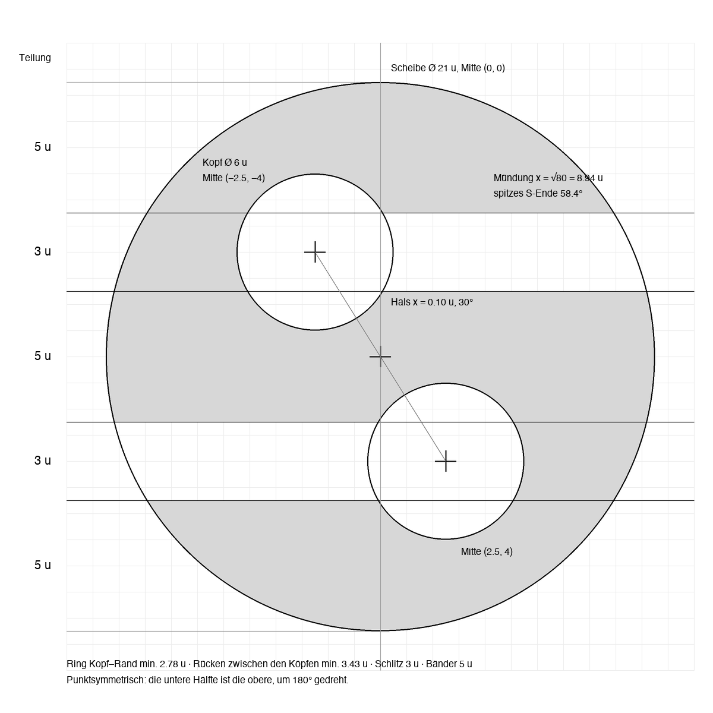

# Siegel – Bildmarke «Schlüssel-S»

Stand 16.10.2026, Feinschliff des Wettbewerbssiegers 03. Quelle der Wahrheit ist `bauen.py`:
Masse dort ändern, `python3 bauen.py` laufen lassen, nie ein SVG von Hand bearbeiten.

## Idee

Eine schwarze Scheibe, ein Siegelstempel, wird von zwei liegenden Schlüssellöchern angeschnitten,
oben von rechts, unten von links. Was an Schwarz übrig bleibt, ist ein S. Die weissen Formen sind
zugleich Schlüssellöcher und Riegel, die von beiden Seiten ins Siegel greifen: zwei Schlösser für den
hybriden Notfallschlüssel (ML-KEM-1024 + X25519), der hält, solange eines der beiden Verfahren hält.
Das Zeichen besteht aus drei Kreisen (Scheibe, zwei Köpfe) und vier Geraden, sonst nichts.

## Konstruktion (Einheit u)

| Element | Mass |
|---|---|
| Scheibe | Ø 21 u, Mitte (0, 0) |
| Senkrechte Teilung | 5 · 3 · 5 · 3 · 5: drei Bänder, zwei Schlitze. Kanten bei y = ±2.5 u und ±5.5 u (vom oberen Rand: 0, 5, 8, 13, 16, 21 u) |
| Schlitze | 3 u breit, gerade, Achsen bei y = −4 u (Mündung rechts) und y = +4 u (Mündung links) |
| Schlüssellochkopf | Ø 6 u = 2 × Schlitz (klassisches Schlüsselloch-Verhältnis) |
| Kopfmitten | (−2.5 u, −4 u) und (+2.5 u, +4 u) |
| Hals (Ansatz Schlitz am Kopf) | scharf, bei 30° (sin 30° = 1.5 / 3), also √6.75 = 2.60 u neben der Kopfmitte: x = ±0.10 u, praktisch auf der Mittelachse |
| Mündungen am Rand | Aussenkante y = ∓5.5 u bei x = ±√80 = ±8.94 u (spitzes S-Ende, 58.4°, scharf); Innenkante y = ∓2.5 u bei x = ±√104 = ±10.20 u |
| Materialstärken | Ring Kopf–Rand min. 2.78 u, Rücken zwischen den Köpfen min. 3.43 u, Schlitz 3 u, Bänder 5 u |
| Schwarzanteil | 67.6 % der Scheibe (vorher 70.8 %) |

Das Zeichen ist punktsymmetrisch (180°), darum ohne optische Korrektur zentriert. Es ist ein einziger
geschlossener Umriss ohne Löcher, gebaut nur aus Kreisbögen und Geraden.

## Dateien

| Datei | Zweck |
|---|---|
| `logo.svg` | Zeichen mit enger viewBox `0 0 22 22`: Koordinaten sind direkt u, Rand 0.5 u. Für die App |
| `icon-ebene.svg` | Ebene für Icon Composer: schwarzes Zeichen auf transparent, viewBox 0 0 1024 1024 (siehe unten) |
| `icon-vorschau.svg` | nur Ansicht: weisser Körper 824 bei (100, 100), r 185, Ebene so abgebildet wie im System, ohne Schatten |
| `SiegelMark.swift` | `public struct SiegelMark: Shape`, dieselbe Geometrie, mit `riegel` für die Entsperr-Animation |
| `render/` | Icon 1024–16 px (auf #EDEDED), Logo 176 und 512 px, `vorher-nachher.png`, `konstruktion.png` |
| `render/pruefung/` | Prüfbilder aller Runden (Varianten, Dock, Systemrender, Glas-Optionen, SwiftUI gegen SVG) |
| `werkzeuge/systemtest.py` | baut aus `icon-ebene.svg` ein .icon, übersetzt mit actool, lässt macOS das Icon zeichnen und misst |

## App-Icon (Icon Composer, macOS 26)

- **Messbefund, wichtig:** actool legt die 1024er-Leinwand der Ebene auf den *ganzen Körper* (824 px im
  1024er-Icon), nicht 1:1 auf das Icon mit Körper bei 100..924. Eine Ebene mit 504-px-Scheibe ergab im
  fertigen Icon nur rund 405 px (49 % statt 61 %). Darum baut `bauen.py` die Ebene um 1024/824 grösser:
  Scheibe 626.3 px in der Ebene (u = 29.83) ergibt im fertigen Icon 504 px (u = 24) = **61.2 % des
  Körpers**. Mit `werkzeuge/systemtest.py` nachgemessen: 61.2 % bei 1024, 61.5 % bei 256 und 64 px.
- Keine eingebackenen Schatten, kein eigener Squircle in der Ebene: Körper, Schatten und Glas zeichnet
  das System.
- **Empfehlung für icon.json:** Füllung weiss, Gruppe mit `"shadow": {"kind": "none"}`,
  `"specular": false`, Transluzenz aus. Grund (`render/pruefung/6-glas-optionen.png`): Die Glanzkante legt
  eine graue Linie in die schwarzen Kanten und der Gruppenschatten färbt die Schlüssellöcher oben grau.
  Flach ist das Icon identisch mit dem Zeichen in der App; Körper-Glas und -Schatten bleiben trotzdem.
- Dunkles Erscheinungsbild: Mit nur weisser Füllung bleibt das Icon auch im Dunkelmodus weiss mit
  schwarzem S (gemessen). Eine Dunkel-Variante wäre Füllung #000 mit weissem S; das Zeichen trägt
  invertiert (`render/pruefung/1-varianten-kopf-hals-keil.png`, zweite Zeile).
- Kleinformate: Pro Grösse eigene Pixel-Fassungen sind im .icon-Format nicht vorgesehen. Das System
  rendert 16 pt mit grösserem Körper (87.5 % der Kachel statt 80.5 %) und weicht die Kanten selbst auf.
  Gemessen ändert sich die Schärfe der Schlitze zwischen u 23.5 und 25.5 kaum
  (`render/pruefung/4-system-u-sweep.png`). Bei reiner Vektor-Rasterung (`icon-vorschau.svg`) liegen die
  Schlitzkanten mit u 24 bei 16 px 1/16 px, bei 32 px 1/8 px neben dem Raster, symmetrisch oben und
  unten. Das S bleibt bei 16 px lesbar, die Köpfe erscheinen als Kerben.

## Grössen in der App

- **Pixelgenau** wird das Zeichen, wenn die Scheibe ein Vielfaches von 21 pt misst und auf ganzen Punkten
  liegt: Dann ist u eine ganze Zahl an Punkten, und alle Schlitzkanten (0, 5, 8, 13, 16, 21 u) fallen auf
  Pixelgrenzen, bei @1x und @2x (`render/pruefung/9-klein-16-20-21-42px.png`).
- Sperrbildschirm und Einrichtung: Scheibe **84 pt** (u = 4 pt), also `SiegelMark().frame(width: 84,
  height: 84)` oder `logo.svg` in einem 88-pt-Rahmen. Abstand zum Passwortfeld mindestens eine
  Scheibenhöhe (`render/pruefung/8-sperrbildschirm-84pt.png`).
- Seitenleiste: Scheibe **21 pt** (u = 1 pt) statt 16–20 pt. Bei 16 und 20 pt werden die Schlitze grau.
- Schutzraum: ringsum mindestens **5 u** (eine Bandstärke) frei von Text und anderen Elementen.
- Mindestgrösse: Bildschirm 16 px Scheibe (darunter verschwinden die Köpfe), empfohlen ab 21 px; Druck
  8 mm Scheibe (Schlitz dann 1.1 mm).
- Farben: nur #000 auf Weiss oder Weiss auf #000. Keine Grautöne, keine Konturen, keine eigenen Schatten,
  nicht auf Fotos. Nicht drehen, nicht spiegeln (gespiegelt wird es ein verkehrtes S).

## Bewegung

`SiegelMark(riegel:)` schiebt beide Schlüssellöcher um bis zu 3 u Richtung Mündung: Die Riegel gleiten
aus dem Siegel. Entsperren: `withAnimation(.easeOut(duration: 0.18)) { riegel = 1 }`, ohne Federn, danach
Übergang zum Tresor. Falsches Passwort: kurz `riegel` 0 → 0.15 → 0 (bei 84 pt rund 2 pt) zusammen mit dem
Schütteln des Feldes. Werte von −0.5 bis 1.5 bleiben geometrisch gültig.

## Entscheide aus dem Feinschliff

Die Jury war sich in drei Punkten nicht einig. Entschieden per Sichtvergleich, Belege in `render/pruefung/`.

1. **Kopf Ø 5 u → 6 u, Mitten (±3, ±4) → (±2.5, ±4)** (Vorschlag Marke, Variante d). Das Verhältnis 2 : 1
   zwischen Kopf und Schlitz ist das klassische Schlüsselloch; die Lesart «Leiterbahn mit Lötpad» oder
   «Schieberegler» verschwindet. Geprüft gegen ±2 u (Ring = Rücken = 3 u, aber der Rücken wirkt
   eingeschnürt und die Köpfe drängen zur Mitte) und ±3 u (Ring nur 2.5 u, die Köpfe kleben am Rand und
   werden wieder zu Pads). ±2.5 u hält Ring 2.78 u und Rücken 3.43 u im Gleichgewicht.
2. **Hals scharf, keine Hohlkehle** (Marke, gegen Handwerk). Mit r 0.4 u wird die weisse Form zum
   Tropfen einer Leiterplatte und weicher; unter 256 px ist der Unterschied unsichtbar. Scharf passt zum
   Schnitt-Gedanken, und das Zeichen bleibt mit Zirkel und Lineal konstruierbar und in Swift exakt.
3. **Spitze S-Enden scharf** (Marke, gegen Handwerk r 0.15–0.2 u). Bei 64–256 px kein sichtbarer
   Unterschied (0.15 u sind bei 128 px 0.45 px), das «Glitzern» bleibt also gleich. Gross wirkt die
   Rundung wie Zahnpasta; die Spitze ist der Schnitt.
4. **Schlitz gerade, kein Keil.** Ein Keil 2.75 → 3.25 u liest sich etwas mehr als Schlüsselloch, macht
   aber die Bänder keilförmig, das S unruhig und nimmt den Kanten das Pixelraster. Die 2 : 1-Köpfe
   reichen für die Lesart.
5. **Icon u = 24 (61.2 %) statt 25 (63.7 %)** (Marke, gegen Handwerk). Im Dock-Vergleich tragen beide;
   u 24 lässt 160 px Luft zum Körperrand und wirkt ruhiger. Weil die Scheibe von 483 auf 504 px wächst und
   die Köpfe grösser werden, bleibt das Schwarz im Icon etwa gleich schwer (+4 %). Bei reiner Rasterung
   liegen die Schlitzkanten mit u 24 näher am Pixelraster; im Systemrender ist der Unterschied klein.
6. **Ebene um 1024/824 skaliert** (Messbefund oben) und eingebackene Schatten entfernt.

## Zweites Markenelement: Gitter (Empfehlung)

Ein Punktgitter auf demselben u-Raster (Abstand 3 u = Schlitz, Punkt Ø 1 u, schwarz) erzählt leise die
gitterbasierte Kryptografie hinter ML-KEM: «Der Zugang ist aus dem Gitter geschnitten». Nur gross und nur
ausserhalb der App-Oberfläche: Notfallkit-PDF, About-Fenster, allfällige Website. Nie im Icon, nie hinter
dem Zeichen, nie unter 256 px (es wird sonst grau). Die App selbst bleibt weiss und ruhig.

## Offen

- `SPEC.md` §9 nennt noch `design/logo.svg → App-Icon`; für das .icon gilt `icon-ebene.svg`.
- Wortmarke «Siegel» neben dem Zeichen (Vorschlag Jury): Versalhöhe 13 u, Abstand 5 u, SF Pro Display
  Semibold; das S der Wortmarke nicht durch das Zeichen ersetzen. Noch nicht gebaut.
- Vor einer Veröffentlichung kurz gegen S-im-Kreis-Marken prüfen (Krypto-Tokens, Fintech).
